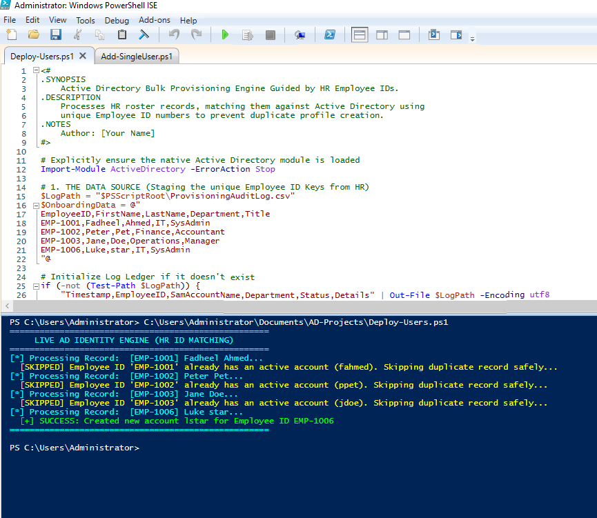
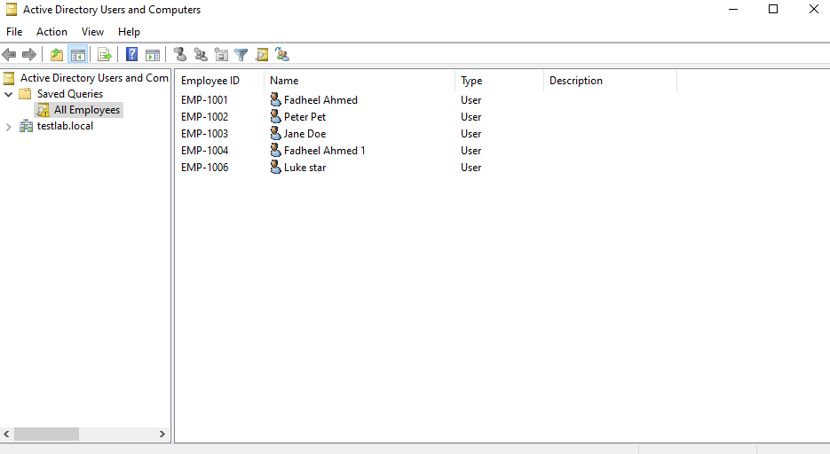

# Enterprise Active Directory Engineering & Automation Portfolio

A Windows Server 2022 lab project demonstrating Active Directory administration, identity provisioning, account management, and administrative console customisation using PowerShell and native Windows Server tools.

The project focuses on automating repetitive IT administration tasks, improving identity data consistency, and documenting practical solutions relevant to IT support and systems administration environments.

## Project Environment

| Component | Configuration |
|---|---|
| Operating System | Windows Server 2022 |
| Directory Service | Active Directory Domain Services (AD DS) |
| Domain | `testlab.local` |
| Target OU | `OU=Employees,DC=testlab,DC=local` |
| Automation | Windows PowerShell 5.1 |
| Lab Platform | Oracle VirtualBox |

## Project Structure

```text
AD-Projects/
│
├── User-Creation/
│   ├── Add-SingleUser.ps1
│   └── Deploy-Users.ps1
│
├── Password-Management/
│   └── (Scripts to be added)
│
├── Documentation/
│
├── images/
│   ├── .gitkeep
│   ├── Batch_Script_Execution.png
│   └── Custom_EmployeeID_Column.png
│
├── .gitignore
└── README.md
```

## Implemented Solutions

### 1. Bulk User Provisioning

**Script:** `User-Creation/Deploy-Users.ps1`

Automates the creation of Active Directory accounts using structured HR-style input data.

Key features:
- Employee ID validation to prevent duplicate employee records.
- Username conflict detection and resolution.
- Automated account creation.
- Execution status tracking.
- Local audit logging.

### 2. Single User Provisioning

**Script:** `User-Creation/Add-SingleUser.ps1`

A parameter-driven PowerShell script designed to simplify individual user creation.

Key features:
- Mandatory parameter validation.
- Employee ID checking.
- Username and Common Name conflict detection.
- Consistent user account creation within the designated OU.

### 3. Active Directory Console Customisation

Demonstrates customisation of Active Directory Users and Computers (ADUC) using ADSI Edit.

Key features:
- Displaying the `employeeID` attribute in ADUC.
- Modifying the appropriate display specifier.
- Improving visibility of employee information for administrators.

## Screenshots

### Bulk Provisioning



### ADUC Customisation



## Installation and Execution

### Prerequisites

1. Windows Server with the AD DS role installed and configured.
2. A test domain environment.
3. An organisational unit named `Employees`.
4. Active Directory PowerShell module.
5. Appropriate administrative permissions.

### Clone the Repository

```powershell
git clone https://github.com/FadheelShah/ad_identity_provisioner.git

cd ad_identity_provisioner
```

### Execute Bulk User Provisioning

```powershell
.\User-Creation\Deploy-Users.ps1
```

### Execute Single User Provisioning

```powershell
.\User-Creation\Add-SingleUser.ps1 -EmployeeID "EMP-2001" -FirstName "Test" -LastName "User" -Department "IT" -Title "SysAdmin"
```

## Audit Logging

The provisioning scripts generate a local audit log named:

`ProvisioningAuditLog.csv`

Review the log using:

```powershell
Import-Csv .\ProvisioningAuditLog.csv | Format-Table -AutoSize
```

Generated audit logs are excluded from Git tracking.

## Real-World Applications

This project demonstrates practical approaches to:

- Reducing repetitive user provisioning tasks.
- Improving consistency in Active Directory account creation.
- Preventing duplicate identity records.
- Supporting structured employee onboarding.
- Improving administrative visibility through directory customisation.
- Maintaining local records of provisioning operations.

## Future Development

Planned improvements include:

- Automated password resets.
- User account unlocking.
- Account status reporting.
- Active Directory group management.
- Enhanced logging and error handling.
- Additional administrative automation modules.

## Disclaimer

This project was developed and tested in an isolated Windows Server lab environment using Oracle VirtualBox. It is intended for educational and portfolio demonstration purposes and has not been certified for production deployment.
